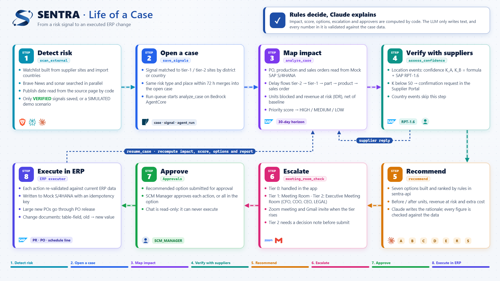

# Sentra

Sentra (Supply Chain Risk & Recovery Agent) is a team of AI agents that watches supply chain risk for an electric motorcycle assembly plant. When a flood, earthquake, port strike, export ban, or new tariff hits a supplier, Sentra computes the impact on purchase orders, production, and sales orders from ERP data, asks the affected suppliers to confirm, and builds recovery options that can be approved and executed in the ERP. Built for the AI Agentic Hackathon 2026 (SAP × AWS).


---

## Features

Click an image to play the video.

### 1. Global risk view

A 3D globe on the dashboard colors each supplier country by the risk level of its open cases.

https://github.com/user-attachments/assets/9d73dd33-e47d-490b-bb50-40c5202f3a93


### 2. Risk heatmap

A country map with PO exposure KPIs that switches between risk level and PO exposure, with a detail panel per country.


https://github.com/user-attachments/assets/b378da9c-1107-4aae-8dee-8bfcb674da66


### 3. Supplier network

An interactive Tier-2 → Tier-1 → part → product graph that highlights the impact path of a case and opens each supplier's profile (recovery time, BCP score).


https://github.com/user-attachments/assets/8c3ae3c8-1aae-4545-bb21-d15acb2480a0


### 4. LIVE mode

Going LIVE scans real news sources, saves only verified signals, links them to a case, and updates the dashboard and globe.


https://github.com/user-attachments/assets/b028e895-5dfb-43a6-976f-b413d87863b6


### 5. Case detail

One page per case with KPIs and escalation, impact tables, supplier verification, and recovery options with before/after figures and the rule behind the choice.


https://github.com/user-attachments/assets/c3f34c8c-a144-42e4-b410-2bb8925ac775


### 6. Agent activity

A timeline of every agent step with the tool it called, its input and output, and the reason for each branch.


https://github.com/user-attachments/assets/c65a37f8-7b9e-4208-8c45-854bec244fbb


### 7. Approve → ERP execution

The SCM Manager approves an option, its actions are written to mock SAP S/4HANA, the case is recomputed, and the ERP log shows each change document.


https://github.com/user-attachments/assets/aed0b835-02f4-4874-ab3b-ba5212f5881b


### 8. Meeting room

High-stakes cases open a Zoom meeting with the right participants and approvers, send email invites, and require a decision note before anything is submitted.


https://github.com/user-attachments/assets/e9222a63-f5f8-431b-b9fa-02dc64caa4d0


### 9. Ask SENTRA chat

A read-only assistant that answers from the case data with source records and refuses to execute ERP actions.


https://github.com/user-attachments/assets/99e476a4-afdc-4b2c-8499-c26ce58e7369

---

## Problem

An assembly plant depends on dozens of suppliers across several countries. A disruption at one tier-2 supplier (for example a magnet plant in China) can stop a tier-1 supplier in another country, which then stops the production line and delays deliveries to customers.

In practice, a supply chain team usually:

1. Learns about the disruption only after a PO arrives late.
2. Works out the impact by hand in spreadsheets: which parts are late, how many motorcycles cannot be built, how much revenue is at risk.
3. Contacts suppliers one by one by email or phone.
4. Picks an action (buy from another source, ship by air, move the schedule) without clear cost and benefit figures.
5. Updates dates and POs in the ERP one at a time.

Every step takes time, and a decision that comes a few days late can mean hundreds of units that cannot be built.

---

## Solution

Sentra runs this flow automatically. Business rules are computed by code; the LLM only explains.

| Capability | How Sentra does it |
|---|---|
| **Risk detection from news** | The `scan_external` agent builds a watchlist from the supplier data, searches Brave News Search and the `sonar` model, and checks the publish date by reading the source page itself. Only `VERIFIED` signals are saved. |
| **Multi-tier impact mapping** | A signal is matched to supplier sites (by district or by country). A tier-2 delay is passed to tier-1 after its buffer, then to parts, production orders, and sales orders within a 30-day horizon. |
| **Impact in Rupiah** | *Units blocked*, *output value*, *PO value*, and *revenue at risk (RAR)* are computed from ERP data. Impact is always net: computed with and without the event, then subtracted. |
| **Priority score** | Each site gets a score from RAR, recovery time, supplier BCP score, and tier. The case score is the highest site score; ≥ 70 is `HIGH`, ≥ 40 is `MEDIUM`. |
| **Supplier verification** | Impact confidence (K_A, K_B) combines a formula with a prediction from the **SAP RPT-1.6** tabular model. Sites with K below 50 are asked to confirm automatically, and their replies update the numbers and the recommendation. |
| **7 recovery options** | A *Protect production*, B *Reschedule*, C *Activate supplier backup site*, D *Expedite shipment*, E *Pull in before effective date*, R *Update ERP dates only*, S *Switch source outside tariff country*. Each option has ERP actions, before/after figures, and extra cost. |
| **Escalation and meetings** | Weighty cases go to a *Meeting Room* (tier 1) or an *Executive Meeting Room* (tier 2). Sentra creates a Zoom meeting, sends invites through Gmail, and requires a decision note before a tier-2 option is submitted. |
| **ERP execution with approval** | The SCM Manager approves actions on the *Approvals* page. The backend validates each action against current ERP data, then writes to mock SAP S/4HANA with an idempotency key. Afterwards the agent recomputes the case. |
| **Reports and chat** | The agent writes an 8–9 section case report (Export PDF through the browser print dialog) and answers questions in chat. Every number in LLM text is checked against the data before it is shown. |

### Life of a case



---

## Architecture


https://github.com/user-attachments/assets/02ddcb97-3c49-4d65-af18-e28e6b064059


| Component | Folder | Role |
|---|---|---|
| **sentra-web** | `apps/sentra-web/` | React 18 + Vite + TypeScript UI. 17 pages, including a 3D globe (three.js), a heatmap (`react-simple-maps` + local TopoJSON), the supplier network (React Flow), and charts (Recharts). The UI computes no business numbers; every figure comes from the API. |
| **sentra-api** | `apps/sentra-api/` | FastAPI: public API, 23 internal tools for the agents, impact engine, scoring, option rules, escalation, number validator, ERP execution, Zoom/SMTP/RPT-1.6 clients, the agent run queue, and the UI build served at `/`. SQLite database (24 tables). |
| **mock-s4** | `apps/mock-s4/` | A mock SAP S/4HANA: OData-style read endpoints (`API_PURCHASEORDER_PROCESS_SRV`, `API_PRODUCTION_ORDER_2_SRV`, `API_SALES_ORDER_SRV`, and more) and write endpoints (PATCH schedule line/item, PR, PO, PO release). SAP-style success and error messages, and change documents shaped like CDHDR/CDPOS. Mounted at `/mock-s4`. |
| **SentraAgents** | `app/SentraAgents/` | LangGraph agents on AWS Bedrock AgentCore, one graph per task. All data goes through `sentra-api` tools; the agents have no ERP write tool. |

### Agent graphs

| Task | Node order |
|---|---|
| `analyze_case` | `load_case → schedule_check → map_network → compute_impact → score → branch_scope →` (location: `assess_confidence → [request_verification]`) `→ recommend → request_option_confirmation → meeting_room_check → report_refresh` |
| `resume_case` | `load_case → apply_replies → compute_impact → score → recommend → request_option_confirmation → meeting_room_check → report_refresh` (triggered by a supplier reply or an ERP execution) |
| `scan_external` | `build_watchlist → plan_queries → (search_brave ‖ search_sonar) → join_sources → screen_candidates → verify_dates → extract_signals → filter_signals → save_signals` |
| `recommend` | `load_case → recommend` (ReAct agent with a single `simulate_plan` tool) |
| `generate_report` | `load_case → get_report_data → write_report` (sections written in parallel, up to 4) |
| `chat` | `execution_policy` (execution requests, no LLM) or `load_case → answer` (ReAct agent with read-only tools) |

---

## Tech stack

| Layer | Technology |
|---|---|
| Agents | Python 3.11, LangGraph, LangChain, `bedrock-agentcore` |
| Models | SAP Cloud SDK for AI (`sap-ai-sdk-gen==7.4.1`): `anthropic--claude-4.6-sonnet` via `ChatBedrockConverse`, `sonar` via the native OpenAI client, `sap-rpt-1.6` via `RPTClient` |
| Agent runtime | AWS Bedrock AgentCore Runtime (ap-southeast-2), deployed with the `@aws/agentcore` CLI + CDK, secrets in AWS Secrets Manager |
| Observability | OpenTelemetry (`opentelemetry-instrumentation-langchain`, `aws-opentelemetry-distro`) |
| Backend | FastAPI, SQLAlchemy 2, SQLite, Pydantic Settings, `httpx`, `boto3`, pytest |
| Frontend | React 18, Vite, TypeScript, React Router, TanStack Query, Recharts, React Flow (`@xyflow/react`), `react-simple-maps`, three.js, `motion`, Vitest + Testing Library |
| News | Brave News Search API, `sonar` |
| Meetings and email | Zoom API (Server-to-Server OAuth), Gmail SMTP |
| Deployment | SAP BTP Cloud Foundry (ap10, `python_buildpack`) |

---

## Technical challenges and design decisions

### 1. The LLM never decides, it only explains

Recovery options, the chosen option, the rule reason (`rule_reason`), risk level, escalation tier, meeting participants, and approvers are computed by pure functions in `sentra-api` (`recommendation_rules.py`, `escalation.py`, `priority.py`). The LLM only writes the explanation.

To stop LLM text from drifting away from the rule result, `graphs/recommend.py` has a `contradictions()` function that detects English phrasing such as *"we recommend Option B"* or *"Option B is the better choice"*. Text that recommends a different option is dropped, rewritten once, and logged as `LLM_OVERRIDDEN` in the agent trace.

### 2. Every number in LLM text must exist in the data

`number_validator.py` extracts every number from LLM text (including `1.25B`, `1,250,000,000`, `42,5`, percentages, and dates) and matches it against the JSON the LLM was given. What happens on failure:

| Part | First failure | Second failure | Third failure |
|---|---|---|---|
| Option rationale, report | Rewrite only the part with the offending number | Server template | — |
| Chat | Rewrite with a correction | Answer without numbers | Fixed template |

Chat citations are also computed by code, from IDs and URLs that exist in the data and appear in the answer.

### 3. Live news is verified by code, not by the search engine

Search engines often get dates wrong (an old page shows up as fresh news). The `scan_external` pipeline handles this with:

1. **Queries from data.** The watchlist is built from tier-1/2 sites and import origin countries. The query language follows the location's country (Indonesian, Chinese, Japanese, or English) and uses local place names from the data. No place names live in code or prompts.
2. **Parallel search.** Brave (up to 36 requests, 30-second budget) and `sonar` (up to 7 questions) run at the same time.
3. **Read the date from the source page.** `tools/verify.py` fetches up to 48 pages with 6 workers (10-second budget) and finds the publish date from JSON-LD, meta tags, `<time>`, the URL path, or the text (including `年月日` and the `令和` era). The earliest candidate wins. Window: 7 days for local events, 14 days for policy.
4. **The LLM only answers yes/no.** `tools/evidence_judge.py` builds a narrow question per article; Claude answers yes or no with one reason from a fixed list. Code re-checks the answer and builds the signal; location and URL come from the candidate, never from LLM text.
5. **`VERIFIED` rule.** A local event needs ≥ 2 independent domains, or 1 official disaster/weather domain, or 1 trusted public news agency. Signals that fail are not saved.

News content is always wrapped in `<external_content>` in the prompt, and fake closing tags inside it are neutralized (prompt-injection defense).

### 4. Net impact and tier-2 propagation

`impact_engine/engine.py` simulates stock, PO arrivals, and BOM demand per production order twice: with the event and without it. Only the difference counts as impact, so shortages that existed before the event are not charged to it. A tier-2 delay is passed to tier-1 after subtracting `buffer_days`, and for logistics events an air-shipped PO only suffers the delay coming from tier 2.

### 5. Auditable formulas

| Formula | Definition |
|---|---|
| Site score | `0.40 × N_RAR + 0.25 × N_TTR + 0.20 × (100 − BCP) + 0.15 × N_tier`; N_RAR capped at IDR 1B, N_TTR capped at 30 days, tier 1 = 100, tier 2 = 60 |
| BCP score | 8 answers (1–5) in 4 categories: governance 15%, resilience 30%, supply chain 25%, testing 30% |
| Confidence | `K = 0.5 × formula + 0.5 × 100 × P(RPT-1.6)`; when RPT is unavailable, `K = formula` |
| Option choice (disruption) | A protecting option (A, C, D) that leaves 0 units blocked and costs ≤ 10% of the output it protects; the cheapest wins, otherwise B |
| Option choice (tariff) | The option (E or S) with the largest saving |
| Escalation tier 2 | Option cost above the SCM approval limit (IDR 100M), units still blocked after the option, a political event with RAR > 0, or extra duty above IDR 250M |
| Escalation tier 1 | HIGH score and option B delays sales orders, option cost near the 10% limit (±2 points), or a supplier that did not reply |

Money is stored as integer Rupiah. Rounding uses `Decimal` half-up to one decimal, not Python's built-in `round()`.

### 6. One code path for DEMO and LIVE

The application mode (`DEMO`/`LIVE`) lives in process memory and always starts as `DEMO`. The mode only decides whether a live news scan may run. Impact, scoring, recommendations, and reports use the same code. The `SIMULATED` badge follows the signal's origin (`engine = DEMO`), not the application mode.

Anti-hardcode tests scan the application code and agent prompts: no location, supplier, or reference number from the seed files may appear. Every result must come from data.

### 7. Safe ERP execution

- The agents have no ERP write tool. Chat refuses execution requests in code, without calling the LLM.
- An action is sent only after the SCM Manager approves it, and it is validated again against the ERP data at that moment (`execution_rules.py`).
- Every write carries an `X-Idempotency-Key`: a repeated request never creates a duplicate document.
- mock-s4 behaves like SAP: a new PO worth ≥ IDR 100M enters *In release* (`03`) and must be released, items with deletion flag `L` refuse changes, and every change is recorded as a change document (change number, table-field, old and new value).
- For tier-2 escalations, an option cannot be submitted before the meeting decision note is saved (`409 Meeting decision required before submitting`).

### 8. Latency and agent limits

- Each run is limited to 120 seconds and 25 tool calls (`analyze_case`/`resume_case` 29, `scan_external` 50); going over returns `AGENT_TIMEOUT`.
- `main.py` loads no heavy SDK at startup. Graphs are imported per task on first use, then cached.
- Independent LLM calls run in parallel (up to 4): one rationale per option and one call per report section.
- `sentra-api` keeps a pool of AgentCore sessions warmed with a `ping` task, runs up to 4 runs in parallel (one run per case), and retries a call only when the request never reached the agent.

---

## Project structure

```
.
├── app/
│   └── SentraAgents/              LangGraph agents (AWS Bedrock AgentCore)
│       ├── main.py                Entrypoint: payload → graph per task → JSON result
│       ├── graphs/                One file per task + common.py (trace, time limits, shared nodes)
│       ├── tools/                 sentra-api tool client, Brave, sonar, date verification, evidence judge
│       ├── model/                 Model factory through SAP Cloud SDK for AI
│       └── prompts/               System prompts
└── apps/
    ├── sentra-api/
    │   └── sentra_api/            FastAPI backend
    │       ├── impact_engine/     Location and country impact (pure functions)
    │       ├── erp/               HTTP client for mock S/4HANA
    │       ├── integrations/      Zoom, Gmail SMTP
    │       ├── routers/           Public API (/api) and internal tools (/internal/tools)
    │       ├── services/          Logic that touches the database
    │       ├── priority.py        Site score, BCP, level, Rupiah format
    │       ├── confidence.py      K_A, K_B + RPT-1.6 client
    │       ├── recommendation_rules.py  7 options, simulate_plan, option choice
    │       ├── escalation.py      Escalation tier 0/1/2
    │       ├── execution_rules.py ERP action validation
    │       ├── number_validator.py Number check for LLM text
    │       └── agent_runner.py    Run queue + AgentCore caller
    ├── mock-s4/
    │   └── mock_s4/               Mock SAP S/4HANA (read, write, change documents)
    └── sentra-web/
        └── src/                   React UI
            ├── pages/             One folder per page
            ├── components/        Shared components
            ├── api/               API client, types, TanStack Query hooks
            └── lib/               Formatting and helpers
```
